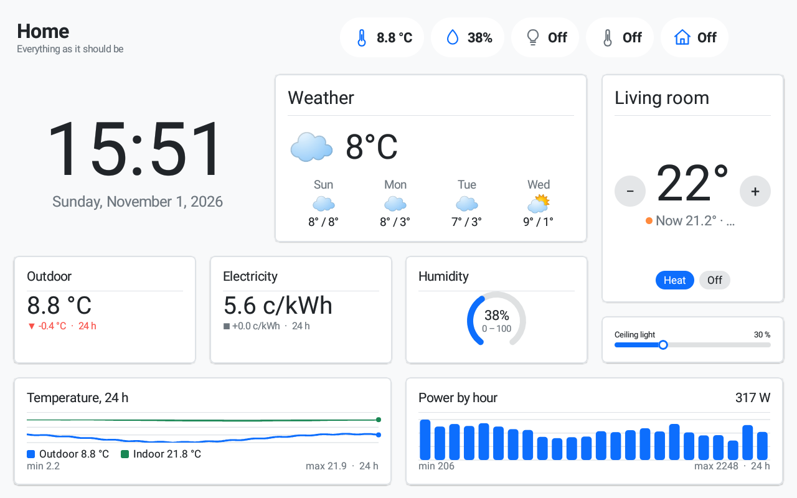
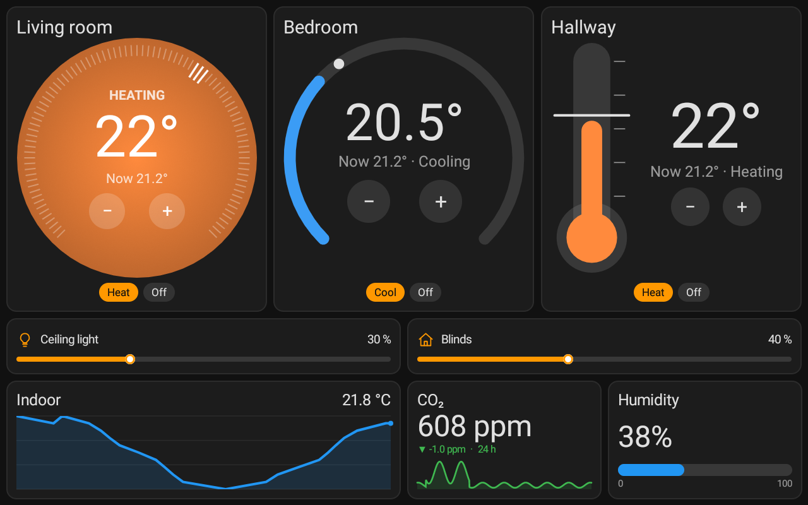

# biwurth

**A wall panel for your home on any Android tablet.** biwurth turns a tablet into a fast, native
(not web-view) dashboard: pages of tiles you swipe between, designed on a website the tablet hosts
itself, fed by Home Assistant or by its own data sources (HTTP, MQTT, Modbus TCP, status checks),
and locked down as a kiosk. It shows up in Home Assistant as a device, wakes when someone walks
up, and has an API that people, scripts and LLMs can build layouts with.

| | |
|---|---|
|  |  |
|  |  |
|  |  |
|  |  |

*Screenshots are drawn by the panel itself (`/api/screenshot`) from generated demo data.*

## What it does

- **Tiles, each with several looks**: clock (digital, analog) · value (number, trend with a
  sparkline, gauge, progress bar) · toggle (lights up, switch, icon) · slider for dimmers,
  covers, fans, volume and numbers · thermostat (dial, ring, numbers, bar, pill, thermometer;
  one or two setpoints, set by dragging the dial) · graph (line, hourly bars, sparkline) ·
  weather · calendar (list, week, month) · camera (go2rtc, RTSP, HLS) · chips (a status row) ·
  heading · empty space with a picture (SVG too).
- **Themes**: colours, fonts, card shape, borders, shadows, gaps, icons, graph and calendar
  styling, as zip packages with their own pictures and page templates. Built in: Aurora, Ant
  Design (light and dark), Bootstrap (light and dark), Chakra UI (light and dark), Evergreen,
  Mushroom (light and dark) and Bubble Card (light and dark). `tools/theme-from-tokens.py`
  makes a theme from any design system's tokens.
- **Looks the same on any screen**: a layout keeps its proportions on a 7" tablet, a 10" one or a
  TV, in landscape or portrait.
- **Presence**: wakes the panel when someone moves in front of it. A calibration checks the
  tablet's camera and sensors where it hangs and makes a plan; Home Assistant gets Motion and
  Room brightness sensors. Camera frames are looked at on the tablet and dropped.
- **Your own data, with or without Home Assistant**: HTTP/JSON, MQTT topics, status checks and
  Modbus TCP, as entities every tile can show, with two weeks of history on the tablet.
- **Kiosk**: device owner, locked to the panel, silent updates from GitHub releases, set up from
  a QR code on a factory-reset tablet.
- **Home Assistant device** over MQTT: screen, brightness, page, sleep timeout, motion, battery
  and more.
- **API for people, scripts and LLMs**: `http://<tablet>:2323/llms.txt` describes it all; check a
  layout without saving, screenshot a draft, edit single tiles, undo, benchmark.

Any Android 8.0+ tablet works. Very old Android versions have a few limits (see below).

## Getting started

1. Install the latest APK from [Releases](../../releases) (or set up a factory-reset tablet from a
   QR code, below).
2. Open biwurth and tap the panel's top-left corner five times for Settings: it shows the
   website address and the key.
3. Open `http://<tablet IP>:2323` in a browser and enter the key. Add Home Assistant on the
   Sources tab (URL and a long-lived access token), then build pages on the Layout and Tile tabs,
   or start from a page template and a theme.
4. **Compile & save**: the tablet checks the layout, preloads its data and switches to it.

`http://<tablet IP>:2323/#key=<key>` logs in directly; give the tablet a fixed IP.

## Website

- **Layout**: drag tiles to move, drag the corner to resize; pages, page templates, orientation,
  grid, theme, gap, card and tile styling, animations; themes to import, use, export or make
  from the current look.
- **Tile**: type, entity, look and the type's own settings.
- **Compile & save**: checks overlaps, sizes, missing or wrong entities, cameras and pictures;
  preloads history, forecasts, calendars and pictures; reports the drawing cost.
- **Sources**: Home Assistant and biwurth's own data sources (below).
- **Cameras**: go2rtc address, live stream limit, live while the backlight is off.
- **Screen**: sleep timeout and mode, brightness, FPS counter, presence and its calibration,
  a benchmark.
- **Backup**, **Updates**, **Log**, **MQTT**.

## Data sources

Every field of a source becomes an entity `src.<source>.<field>` that any tile can show; numbers
are kept on the tablet for two weeks, so graphs and trends work without Home Assistant.

| Source | Settings | Each field |
|---|---|---|
| Home Assistant | URL, long-lived access token | all its entities (several Home Assistants can be added) |
| HTTP / JSON | URL, interval, headers (API keys) | a JSON path: `current.temperature_2m`, `data[0].value` |
| MQTT topics | the broker from the MQTT tab | a topic and optionally a JSON path; a command topic makes it a button |
| Status checks | interval | an `http(s)://` URL or `host:port`; also `<field>_ms` |
| Modbus TCP | host, port, unit id, interval | holding/input register (int16 … float32, word order, scale) or coil/discrete input; a coil is a button |

Each source can also record **telemetry** (readings and events, a CSV per day) to download from
the website.

## Sleep and presence

| Mode | Asleep | Wakes on |
|---|---|---|
| Backlight off (default) | screen on, backlight 0, black | a touch, motion, MQTT, the API |
| Screen off | screen really off (needs device admin) | the power button, MQTT, the API |

Presence (motion) needs the Backlight off mode: Android stops the camera when the screen is off.
Going to sleep returns the panel to its first page.

## Home Assistant (MQTT device)

With the MQTT integration (Home Assistant 2024.11 or newer) the tablet appears through device
discovery with a screen switch, brightness, sleep timeout and page select, and motion, room
brightness, battery, charging, last touch, Wi-Fi and IP sensors, plus an update entity. Topics
live under `biwurth/biwurth_<id>/`.

## API

Everything under `/api/*`, and `/state`, `/wake` and `/sleep`, needs `Authorization: Bearer <key>`:

```sh
curl -H "Authorization: Bearer $KEY" http://<tablet>:2323/state   # {"screen":"awake"|"dimmed"|"off"}
curl -X POST -H "Authorization: Bearer $KEY" http://<tablet>:2323/wake
```

The full reference, written for LLMs and scripts, is `http://<tablet>:2323/llms.txt` (readable
without the key): tile schema, layout check, automatic placement, page and tile edits, undo,
themes and templates, entity search, presence, benchmark and `/api/screenshot`.

## Tablet setup

### Kiosk mode (device owner)

Android allows a device owner only when no accounts are on the tablet, so remove them first, and
any screen lock PIN. Then over adb:

```sh
adb shell dpm set-device-owner io.github.thinke.biwurth/.AdminReceiver
```

biwurth then configures itself: no lock screen, the home app, locked to the panel (no status
bar, Home or Recents), runtime permissions granted, updates installed silently. Turn kiosk mode
off in the tablet's Settings to reach Android; **Release device owner** there undoes it.

### From a QR code

On a running panel's website, Backup → **Set up a new tablet** shows a QR code (optionally with
Wi-Fi). On a factory-reset tablet's first "Welcome" screen, tap six times in the same spot and
scan it: Android downloads the latest release, checks its signature, and makes biwurth device
owner. Restore a backup to bring a layout over.

### Background

```sh
# No Doze or app standby, so MQTT and the website stay up with the screen off
adb shell cmd deviceidle whitelist +io.github.thinke.biwurth
adb shell am set-standby-bucket io.github.thinke.biwurth active   # Android 9+
```

For a power menu instead of the assistant on a long press of the power button:
`adb shell settings put global power_button_long_press 1`.

**Older Android:** on 8.0/8.1 app standby buckets don't exist (skip that command), kiosk mode
hides only what Android decides, and before Android 12 updates without device owner ask for
confirmation.

## Building

```sh
./gradlew assembleRelease
adb install -r app/build/outputs/apk/release/app-release.apk
```

Use a release build on a tablet: debug builds are several times slower. Release signing comes
from the environment (`BIWURTH_KEYSTORE`, `BIWURTH_KEYSTORE_PASSWORD`, `BIWURTH_KEY_ALIAS`,
`BIWURTH_KEY_PASSWORD`); without it, local release builds use the debug key.

Pushing a tag `v1.2.3` builds a signed APK on GitHub Actions and publishes a release with its
`.sha256`; a suffix (`v1.2.3-rc1`) makes a pre-release. The workflow takes the keystore from
the repository secrets `BIWURTH_KEYSTORE_BASE64` (`base64 -w0 release.jks`),
`BIWURTH_KEYSTORE_PASSWORD`, `BIWURTH_KEY_ALIAS` and `BIWURTH_KEY_PASSWORD`. Panels check for
releases daily and install updates signed with the same key.

## Planned

- **CAN bus**: a USB CAN adapter (slcan, gs_usb) over Android's USB host API, `socketcand` over
  the network, or a CAN → MQTT bridge; frames decoded by signal definitions or a DBC file.
- **Uploading logs and telemetry** on a schedule: HTTP, MQTT or a network share.

## License

MIT, see [LICENSE](LICENSE). The bundled Inter font is under the SIL Open Font License
([licenses/Inter-OFL.txt](licenses/Inter-OFL.txt)).
