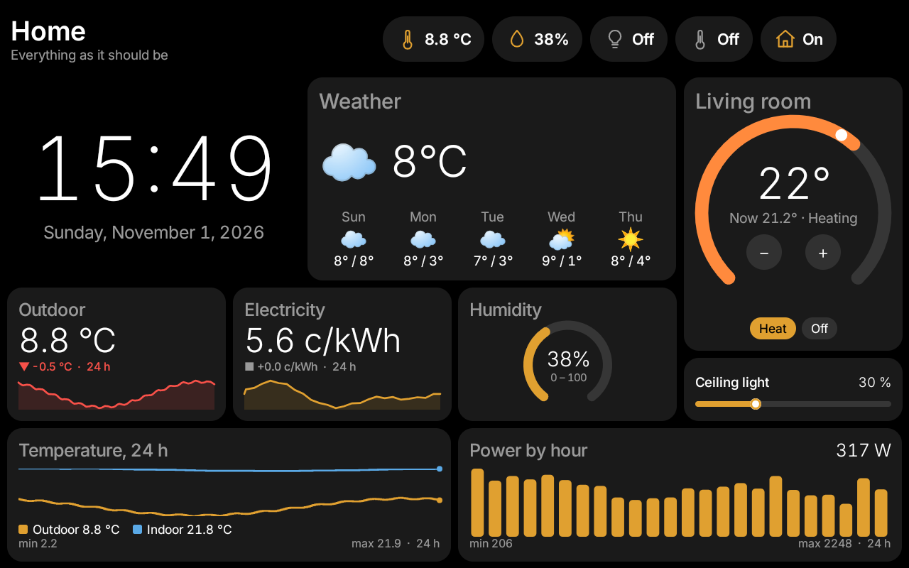
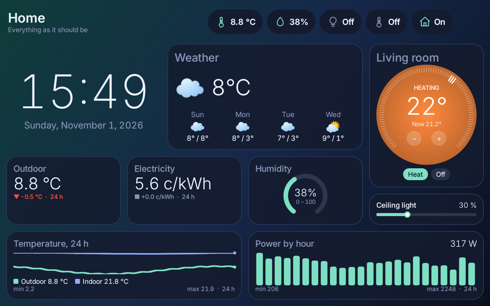
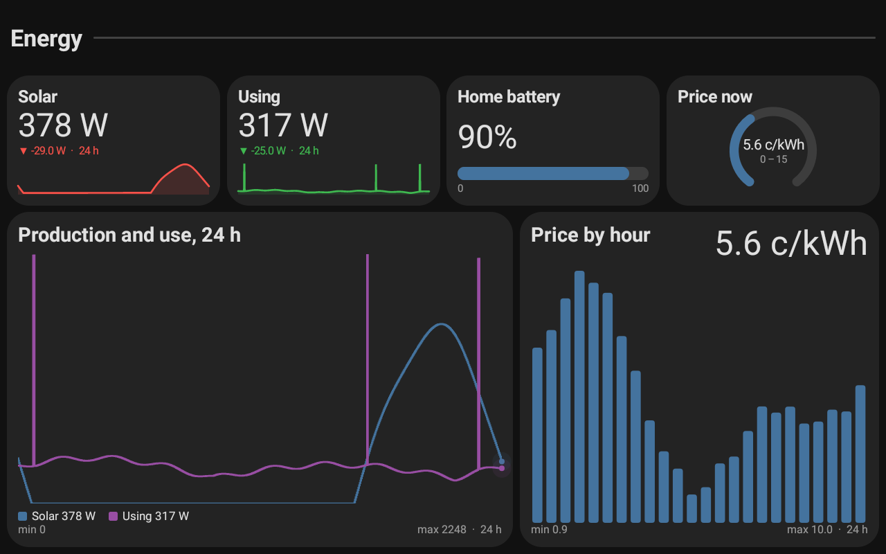
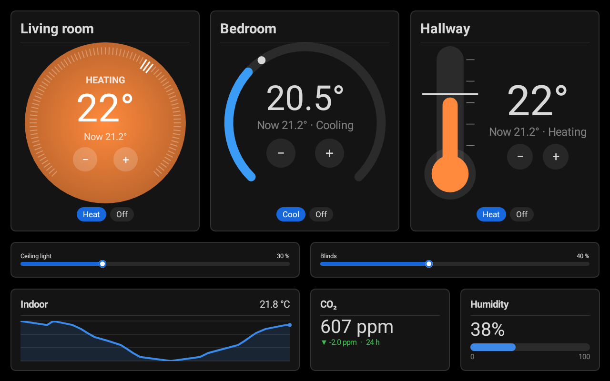
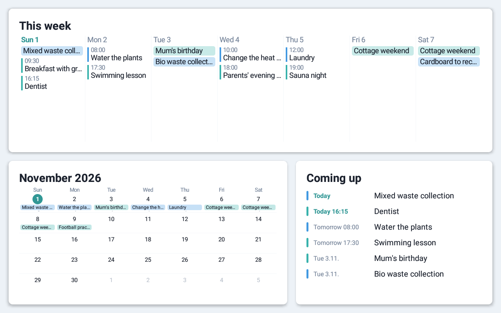
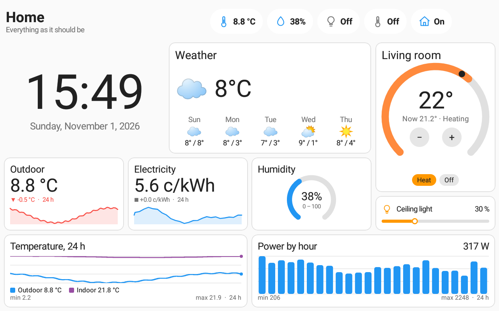

# biwurth

**A wall panel for your home on any Android tablet.** A fast, native dashboard of tiles you swipe
between, designed on a website the tablet hosts itself, fed by Home Assistant or its own data
sources, locked down as a kiosk.

| | |
|---|---|
|  |  |
|  |  |
|  |  |

*Drawn by the panel itself from generated demo data.*

## Features

- **Tiles with several looks each**: clock, values (trend, gauge, progress), toggles, sliders,
  thermostats, graphs, weather, calendars (list, week, month), cameras, chips, headings, pictures.
- **Themes** as zip packages; built in: Aurora, Ant Design, Bootstrap, Chakra UI, Evergreen,
  Mushroom and Bubble Card, light and dark.
- **Data** from Home Assistant, HTTP/JSON, MQTT, Modbus TCP and status checks, with history on
  the tablet.
- **Wakes on motion**, calibrated to the tablet's camera and sensors.
- **Kiosk** with silent updates; set up a new tablet from a QR code.
- **Home Assistant device** over MQTT, and an **API** for scripts and LLMs
  (`http://<tablet>:2323/llms.txt`).

Any Android 8.0+ tablet; a layout looks the same on any screen size.

## Getting started

1. Install the APK from [Releases](../../releases).
2. Tap the panel's top-left corner five times: Settings shows the website address and key.
3. Open `http://<tablet>:2323`, add Home Assistant under Sources, build pages, **Compile & save**.

For kiosk mode, make biwurth device owner (no accounts or screen lock on the tablet):

```sh
adb shell dpm set-device-owner io.github.thinke.biwurth/.AdminReceiver
```

## Building

```sh
./gradlew assembleRelease
```

A tag `v1.2.3` builds a signed release on GitHub Actions (keystore from the `BIWURTH_KEYSTORE_*`
secrets); panels update themselves from releases.

## License

MIT, see [LICENSE](LICENSE). Inter font: SIL Open Font License ([licenses/Inter-OFL.txt](licenses/Inter-OFL.txt)).
